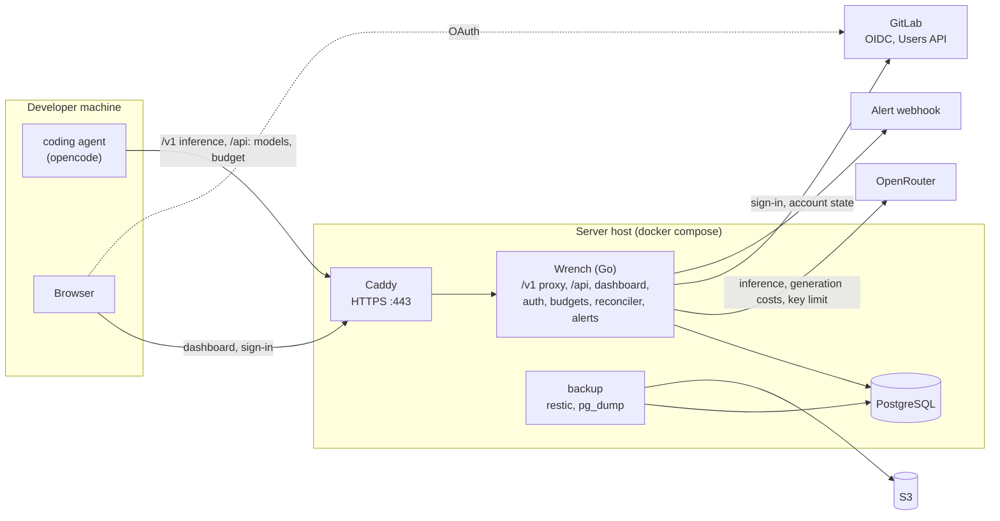

# Wrench

Company-managed access to coding-agent models. Every model call goes through one Wrench server, which signs people
in with GitLab, enforces model tiers and budgets, and records each request with its real cost. Developers use an
unmodified [opencode](https://opencode.ai) 2.3.x: one device login, and the server provides the rest
([setup](agent/opencode/README.md)).

Wrench is built for a team of about 20 on a single node. It is pre-release: nothing is deployed yet.

## Features

- **One route for every model call.** Clients hold only a Wrench device key; the OpenRouter key stays inside the
  server. Prompts to any other provider are refused.
- **GitLab sign-in.** OIDC with PKCE for the dashboard and clients, an email allowlist in `config.yaml`, and
  automatic revocation when an account is blocked in GitLab.
- **Tiers and budgets.** Per-user and shared limits in fixed 5-hour, day, week and month windows; costs are
  confirmed from OpenRouter.
- **Dashboard and alerts.** Live budgets, usage, latency, sessions, keys and users on separate tabs; alerts to Slack or Mattermost.
- **Simple operations.** Four containers, configuration reloaded without a restart, encrypted backups to S3 with a
  scripted restore drill.

## Architecture



A client talks only to Wrench with its device key; it never holds GitLab tokens or upstream credentials. Wrench
checks identity, tier and budget, forwards inference to OpenRouter (Wrench alone holds the OpenRouter key),
records every attempt in PostgreSQL and reconciles its cost from OpenRouter generation metadata. Only Caddy
publishes ports; PostgreSQL and backup sit on an internal network.

## Quick start

Try the server locally with mocked GitLab and OpenRouter. You need Docker, Go 1.27 and Node 22.19+.

```sh
make demo    # Wrench on http://localhost:18080 with 30 days of demo data
opencode auth login opencode --method device --answer server=http://localhost:18080
```

Approve the code on the page opencode opens, signing in by picking a user in the GitLab mock
(`user3@example.com` is an administrator); the dashboard is at the same address. Stop the demo with
`make demo-down`, or delete its data with `make demo-reset`.

## Deploy

Production runs from [deploy/production](deploy/production/README.md): Caddy with HTTPS, Wrench, PostgreSQL
and the backup container. Configure users, tiers and models in `config/config.yaml` and secrets in `.env`, then
`docker compose up`.

## Documentation

| Topic                                    |                                                                         |
| ---------------------------------------- | ----------------------------------------------------------------------- |
| [Configuration](docs/configuration.md)   | Which file owns what, live reload, validation                           |
| [Authentication](docs/authentication.md) | Allowlist, GitLab sign-in, device keys, revocation                      |
| [Budgets](docs/budgets.md)               | Windows, admission, cost reconciliation                                 |
| [Models and tiers](docs/models.md)       | Model catalog, tiers, reasoning effort                                  |
| [Clients](docs/agent.md)                 | What a client sends and gets; opencode support                          |
| [Operations](docs/operations.md)         | Install, backups, updates, rollback, restore, monitoring, alerts, pilot |
| [HTTP API](docs/api.md)                  | The OpenAPI document, credentials, errors, routes outside it            |
| [Development](docs/development.md)       | Repository layout, commands, known gaps                                 |

## Development

```sh
make test    # Go and dashboard tests (server tests use PostgreSQL on port 55432)
make lint
make e2e     # end-to-end tests against a disposable demo stack
make         # every target and variable
```

Contributor and agent workflow: [AGENTS.md](AGENTS.md). Design specifications of the current behavior live in
[docs/specs](docs/specs), starting with the [product requirements](docs/specs/coding-agent-platform.md).
